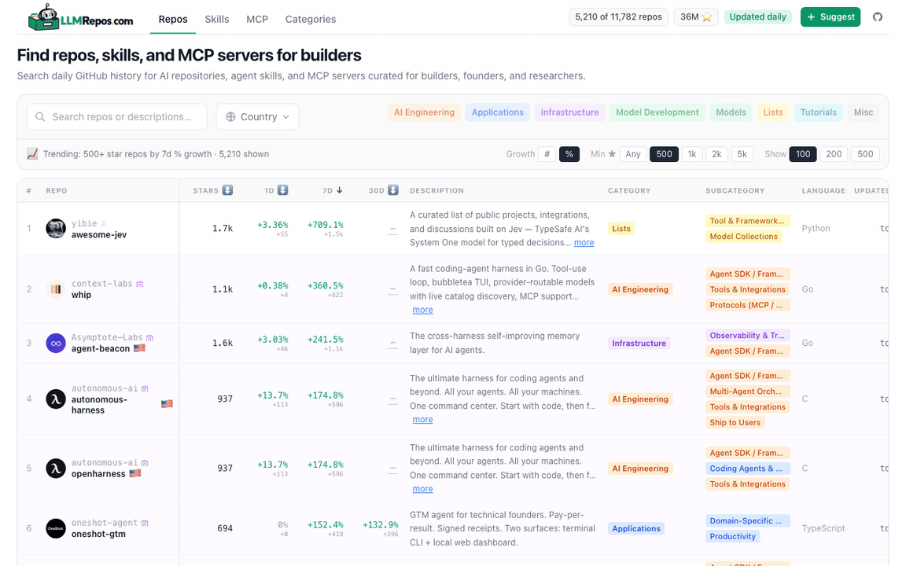

# 👋 Awesome Local LLMs

### 10,000+ open-source LLM, agent, and local inference repos, tracked daily

[**llmrepos.com**](https://llmrepos.com) sorts them by how fast they are gaining stars, not by how many they have.

---

## What this is

A curated list of open-source projects for building with LLMs, covering the whole stack: model weights, training code, inference runtimes, agent frameworks, end-user apps, and the lists and tutorials that help you learn.

Each repo is checked once a day for stars, 1d/7d/30d star growth, forks, contributors, open issues, language, license, creation date, and time since last commit.

Two ways to use it:

- [**llmrepos.com**](https://llmrepos.com) has all 11,000+ repos, with search, growth sorting, and filters by category, subcategory, language, and license.
- **This README** mixes established leaders with projects gaining stars this week, regenerated every Monday.

Projects are organised into eight categories:

- **AI Engineering**: agent SDKs, orchestration, prompting & scaffolding, memory/RAG, tools & integrations, MCP, evaluation, and guardrails
- **Applications**: coding assistants, personal agents, productivity, content creation, research, data analytics, and automation
- **Infrastructure**: local runtimes, production serving, distributed & edge inference, optimisation, gateways, observability, and vector search
- **Model Development**: fine-tuning, training, RLHF, deep learning frameworks, dataset engineering, and interpretability
- **Models**: foundation, vision, audio/speech, embedding, on-device, and domain-specific model releases
- **Lists**: curated collections of prompts, tools, models, papers, and datasets
- **Tutorials**: getting-started guides, courses, roadmaps, and interview prep
- **Misc**: everything else

Each repo is tagged with one **category**, one or more **subcategories**, and a set of cross-cutting **keywords** (techniques, integrations, modalities, and domains such as `RAG`, `MCP`, or `Context engineering`).

**Contributions are welcome!** [Open an issue](https://github.com/vince-lam/awesome-local-llms/issues/new/choose) to suggest a missing repo, correct a listing, or improve the site.

## How the project has changed

This started in 2024 as a markdown list of local LLM tools that I edited by hand and kept in sync with a Google Sheet. It went out of date faster than I could edit it, so it became a pipeline instead.

| | 2024 | 2026 |
|---|---|---|
| Repos tracked | ~40, picked by hand | 8,600+, found via the GitHub API and classified automatically |
| Refresh | Manual, later weekly | Daily, via GitHub Actions into a [Turso](https://turso.tech) (libSQL) database |
| Ranking | Total stars | 1d/7d/30d star growth, so a repo shows up within days of taking off |
| Scope | Local inference and chat UIs | Agents, RAG, coding assistants, serving, model development, evals |
| Surface | This README | [llmrepos.com](https://llmrepos.com), plus this README |

## Elsewhere

- My write-up on local LLM tooling: <https://vinlam.com/posts/local-llm-options/>
- Older exports, no longer updated: [Google Sheet](https://docs.google.com/spreadsheets/d/1Xv38p90V3GiJXjq0a3qc24056Vicn1I5MG6QiFE6nVE/edit?usp=sharing) and [Airtable](https://airtable.com/apparaKqezkq2LECD/shrE26kWFaVU1cvgb)

## Weekly Open-Source LLM & Agent Rankings

These generated rankings combine the 20 most-starred active projects, the 20 largest seven-day movers outside that group, and up to three more movers from each category. Each project appears once. For the complete daily index, search, filters, and longer growth windows, use [llmrepos.com](https://llmrepos.com/?utm_source=github&utm_medium=readme&utm_campaign=readme_funnel).

*Last Updated: 19/10/2026*

<!-- BEGIN_TABLE -->
## Established leaders

The 20 most-starred active projects.

|  # | Repo  |  Stars | 7d growth  | Category  | About  |
|----------|----------|----------|----------|----------|----------|
|  1 | [openclaw](https://github.com/openclaw/openclaw)  | 392,450 | +676 (+0.2%)  | Applications  | The AI that really does things. Any OS. Any Platform. The lobster way. 🦞  |
|  2 | [rea](https://github.com/morluto/rea)  | 330,863 | +192,369 (+138.9%) | AI Engineering | Reverse engineer anything with agents, from app behavior down to native binaries.  |
|  3 | [superpowers](https://github.com/obra/superpowers)  | 301,960 | +3,904 (+1.3%)  | AI Engineering | An agentic skills framework & software development methodology that works.  |
|  4 | [skills](https://github.com/mattpocock/skills)  | 297,052 | +9,585 (+3.3%)  | AI Engineering | Skills for Real Engineers. Straight from my .agents directory.  |
|  5 | [ECC](https://github.com/affaan-m/ECC)  | 283,782 | +6,068 (+2.2%)  | AI Engineering | The agent harness performance optimization system. Skills, instincts, memory, security, and research-first development for Claude Code, Codex, Opencode, Cursor and beyond.  |
|  6 | [hermes-agent](https://github.com/NousResearch/hermes-agent)  | 255,182 | +2,130 (+0.8%)  | AI Engineering | The agent that grows with you  |
|  7 | [deepseek-harness](https://github.com/deepseek-ai/deepseek-harness) | 254,109 | +6,028 (+2.4%)  | AI Engineering | DeepSeek Harness: Everything is a Plugin.  |
|  8 | [opencode](https://github.com/anomalyco/opencode)  | 217,321 | +4,416 (+2.1%)  | Applications  | The open source coding agent.  |
|  9 | [n8n](https://github.com/n8n-io/n8n)  | 207,997 | +882 (+0.4%)  | AI Engineering | Fair-code workflow automation platform with native AI capabilities. Combine visual building with custom code, self-host or cloud, 400+ integrations.  |
|  10 | [firecrawl](https://github.com/firecrawl/firecrawl)  | 192,994 | +2,225 (+1.2%)  | AI Engineering | Supercharge your AI agents with data from the web and beyond. Building the library for superintelligence. 🔥  |
|  11 | [markitdown](https://github.com/microsoft/markitdown)  | 191,061 | +1,309 (+0.7%)  | AI Engineering | Python tool for converting files and office documents to Markdown.  |
|  12 | [AutoGPT](https://github.com/Significant-Gravitas/AutoGPT)  | 187,655 | +123 (+0.1%)  | Applications  | AutoGPT is the vision of accessible AI for everyone, to use and to build on. Our mission is to provide the tools, so that you can focus on what matters.  |
|  13 | [ollama](https://github.com/ollama/ollama)  | 183,817 | +953 (+0.5%)  | Infrastructure | Get up and running with Kimi, GLM, MiniMax, DeepSeek, gpt-oss, Qwen, Gemma and other models.  |
|  14 | [skills](https://github.com/anthropics/skills)  | 182,156 | +1,477 (+0.8%)  | AI Engineering | Public repository for Agent Skills  |
|  15 | [prompts.chat](https://github.com/f/prompts.chat)  | 173,542 | +832 (+0.5%)  | AI Engineering | f.k.a. Awesome ChatGPT Prompts. Share, discover, and collect prompts from the community. Free and open source — self-host for your organization with complete privacy.  |
|  16 | [transformers](https://github.com/huggingface/transformers)  | 167,852 | +267 (+0.2%)  | Infrastructure | 🤗 Transformers: the model-definition framework for state-of-the-art machine learning models in text, vision, audio, and multimodal models, for both inference and training.  |
|  17 | [ponytail](https://github.com/DietrichGebert/ponytail)  | 167,689 | +5,982 (+3.7%)  | AI Engineering | Makes your AI agent think like the laziest senior dev in the room. The best code is the code you never wrote.  |
|  18 | [agency-agents](https://github.com/msitarzewski/agency-agents)  | 161,540 | +2,159 (+1.4%)  | AI Engineering | A complete AI agency at your fingertips - From frontend wizards to Reddit community ninjas, from whimsy injectors to reality checkers. Each agent is a specialized expert with personality, processes, and proven deliverables. |
|  19 | [dify](https://github.com/langgenius/dify)  | 158,888 | +628 (+0.4%)  | AI Engineering | Build Agentic workflows, RAG pipelines, with rich AI model and tool support on one collaborative workspace. Deploy on cloud, VPC, or self-hosted, so teams move from prototype to production without rebuilding the stack.  |
|  20 | [open-webui](https://github.com/open-webui/open-webui)  | 156,153 | +1,441 (+0.9%)  | AI Engineering | User-friendly AI Interface (Supports Ollama, OpenAI API, ...)  |

## Trending this week

The 20 largest seven-day star gains, excluding established leaders.

|  # | Repo  |  Stars | 7d growth  | Category  | About  |
|----------|----------|----------|----------|----------|----------|
|  1 | [VoiceStudio](https://github.com/debpalash/VoiceStudio)  |  76,698 | +16,880 (+28.2%)  | Applications  | VoiceStudio is the open-source, fully-local ElevenLabs alternative — voice cloning, voice design, video dubbing, dictation, transcription & audiobook creation in 646 languages.  |
|  2 | [dsh-our-free-model](https://github.com/zouyuxuan122/dsh-our-free-model)  |  27,138 | +15,799 (+139.3%) | AI Engineering | 在 dsh 里装上这个插件即可，无需登录、注册或填 API Key，就能使用包括 DeepSeek V4.1 Flash、Kimi K3 在内的前沿模型——完全免费，不限量。 All you do is install this plugin in dsh: no login, no sign-up, no API key — the frontier models are just there, DeepSeek V4.1 Flash and Kimi K3 among them. Completely free, with no usage cap.  |
|  3 | [dsh-our-free-model](https://github.com/Ebony-Vinyl/dsh-our-free-model)  |  27,038 | +15,702 (+138.5%) | AI Engineering | 在 dsh 里装上这个插件即可，无需登录、注册或填 API Key，就能使用包括 DeepSeek V4.1 Flash、Kimi K3 在内的前沿模型——完全免费，不限量。 All you do is install this plugin in dsh: no login, no sign-up, no API key — the frontier models are just there, DeepSeek V4.1 Flash and Kimi K3 among them. Completely free, with no usage cap.  |
|  4 | [anatomy](https://github.com/wheresryan22/anatomy)  |  16,529 | +11,457 (+225.9%) | AI Engineering | An agent skill for creating detailed, interactive isometric illustrations of real-world machines and complex systems. Generates polished SVGs with optional WebGL shaders and 3D effects.  |
|  5 | [orca](https://github.com/stablyai/orca)  |  97,780 | +7,286 (+8.1%)  | AI Engineering | Orca is the place for working with a fleet of agents (e.g. Grok Bot, Claude Code). Run any coding agent with your own subscription. Available on desktop, mobile and remote runtime.  |
|  6 | [magpie](https://github.com/yetone/magpie)  |  16,713 | +6,503 (+63.7%)  | Applications  | Every agent's model. One place. Codex on DeepSeek, Claude Code on Kimi, from the menu bar.  |
|  7 | [iFixAi](https://github.com/ifixai-ai/iFixAi)  |  29,871 | +5,818 (+24.2%)  | AI Engineering | Independent Auditing of AI Agents. Run by human or the agent itself, to answer the most crucial question in the AI Agent Economy. Is the agent doing what is supposed to do? With iFixAi you can have this answer in less than 120 seconds.  |
|  8 | [solidcraft](https://github.com/bherbruck/solidcraft)  |  6,469 | +5,590 (+635.9%)  | Applications  | SolidCraft: an open-source parametric 3D CAD application built in pure Rust. Desktop, web, and automation through MCP.  |
|  9 | [solvecraft](https://github.com/bherbruck/solvecraft)  |  6,469 | +5,590 (+635.9%)  | Applications  | SolidCraft: an open-source parametric 3D CAD application built in pure Rust. Desktop, web, and automation through MCP.  |
|  10 | [claude-plugins-official](https://github.com/anthropics/claude-plugins-official)  |  43,076 | +5,352 (+14.2%)  | AI Engineering | Official, Anthropic-managed directory of high quality Claude Code Plugins.  |
|  11 | [xerj](https://github.com/xerj-org/xerj)  |  8,861 | +5,203 (+142.2%)  | Infrastructure | XERJ is the new way for AI to search data. Its autoindex capability activates agents to know your data without the token waste of grep (1974 tool). One command indexes code, docs, logs and PDFs for search, RAG, security audits and agent memory, using 40x fewer tokens than grep. It’s durable and can replace ElasticSearch saving you x10 infra costs. |
|  12 | [Concat](https://github.com/jub0t/Concat)  |  9,287 | +4,311 (+86.6%)  | Applications  | The truly free, open-source, local-first, cross-platform CapCut replacement. Scriptable through a JSON-RPC API & MCP.  |
|  13 | [scientific-agent-skills](https://github.com/K-Dense-AI/scientific-agent-skills)  |  52,841 | +4,294 (+8.8%)  | Applications  | Turn any AI agent into an AI Scientist. The #1 Agent Skills library for science, used by 250,000+ scientists worldwide. 177 ready-to-use validated skills plus 100+ scientific databases covering biology, chemistry, medicine, and drug discovery. Compatible with Cursor, Claude Code, Codex, Pi, Antigravity, and the open Agent Skills standard.  |
|  14 | [taste-skill](https://github.com/Leonxlnx/taste-skill)  |  99,187 | +4,167 (+4.4%)  | AI Engineering | Agent skills that give coding agents taste: art direction, reference images and a browser check instead of generic AI pages  |
|  15 | [context-mode](https://github.com/mksglu/context-mode)  |  30,952 | +3,975 (+14.7%)  | Applications  | Context window optimization for AI coding agents. Sandboxes tool output (98% reduction), persists session memory, and enforces routing across 17 platforms via MCP + hooks.  |
|  16 | [paperclip](https://github.com/paperclipai/paperclip)  | 104,519 | +3,755 (+3.7%)  | AI Engineering | The open-source app everyone uses to manage agents at work  |
|  17 | [freellmapi](https://github.com/tashfeenahmed/freellmapi)  |  37,405 | +3,615 (+10.7%)  | AI Engineering | 7.4 billion tokens per month. 34 free LLM providers. 635 free model endpoints. All behind one /v1 endpoint, plus any custom OpenAI-compatible endpoint. Smart routing, automatic failover, encrypted keys. Personal experimentation only.  |
|  18 | [openGym](https://github.com/DuarteSantos8/openGym)  |  13,753 | +3,584 (+35.2%)  | Applications  | Self-hosted gym & body-weight tracker — plan routines, log workouts (supersets, warm-ups, cardio), see which muscles are trained, fatigued or detrained, import from FitNotes/Strong/Hevy, passkey login. Your data, your server.  |
|  19 | [ai-engineering-from-scratch](https://github.com/rohitg00/ai-engineering-from-scratch) |  71,333 | +3,375 (+5.0%)  | AI Engineering | Learn AI Engineering! Learn it. Build it. Ship it for others.  |
|  20 | [DigUp](https://github.com/ARahim3/DigUp)  |  4,902 | +3,265 (+199.5%)  | Applications  | Search your computer by what's in your files: photos, PDFs, documents, recordings, videos and code. On-device on Mac, Windows and Linux, built on Google DeepMind's EmbeddingGemma 2.  |

## Trending by category

Up to three more weekly movers from each category. Projects already shown above are omitted.

### [AI Engineering](https://llmrepos.com/categories/ai-engineering?utm_source=github&utm_medium=readme&utm_campaign=readme_funnel)

|  # | Repo  |  Stars | 7d growth  | About  |
|----------|----------|----------|----------|----------|
|  1 | [archify](https://github.com/tt-a1i/archify)  |  85,673 | +3,218 (+3.9%) | Turn any idea, plan, or codebase into a beautiful interactive diagram. An agent skill for Claude Code, Codex, and more.  |
|  2 | [graphify](https://github.com/Graphify-Labs/graphify) | 128,834 | +3,056 (+2.4%) | Turn any codebase, with its docs, SQL schemas, configs, and PDFs, into a queryable knowledge graph. A /graphify skill for Claude Code, Cursor, Codex, and Gemini CLI: local deterministic AST parsing, every edge explained, no vector store. |
|  3 | [cc-switch](https://github.com/farion1231/cc-switch)  | 146,272 | +3,031 (+2.1%) | A cross-platform desktop All-in-One assistant for Claude Code, Codex, OpenCode, OpenClaw, Grok Build & Hermes Agent. Only official website: ccswitch.io  |

### [Applications](https://llmrepos.com/categories/applications?utm_source=github&utm_medium=readme&utm_campaign=readme_funnel)

|  # | Repo  |  Stars | 7d growth  | About  |
|----------|----------|----------|----------|----------|
|  1 | [free-claude-code](https://github.com/Alishahryar1/free-claude-code)  |  61,807 | +3,124 (+5.3%)  | Use Claude Code, Codex, VSCode, Pi, and OpenCode (and 6 other harnesses) for free (1.3B+ free tokens) from your terminal, app, IDE, or phone, and now from the browser with native browser sessions (multi-harness + multi-model) like OpenClaw (voice supported + ToS friendly) |
|  2 | [esp32-iphone-agent](https://github.com/onehumanbeing/esp32-iphone-agent) |  3,239 | +3,067 (+1783.1%) | Let an AI model use a real iPhone with a $7 ESP32: AirPlay eyes, USB HID hands, any OpenAI-compatible vision model. No Mac, no developer account, no jailbreak.  |
|  3 | [agent-skills](https://github.com/addyosmani/agent-skills)  | 108,485 | +3,018 (+2.9%)  | Production-grade engineering skills for AI coding agents.  |

### [Infrastructure](https://llmrepos.com/categories/infrastructure?utm_source=github&utm_medium=readme&utm_campaign=readme_funnel)

|  # | Repo  |  Stars | 7d growth  | About  |
|----------|----------|----------|----------|----------|
|  1 | [OmniRoute](https://github.com/diegosouzapw/OmniRoute) |  78,337 | +2,763 (+3.7%)  | Never stop coding. Free MIT AI gateway: one endpoint, 375 providers (150+ free), 1,400+ models Kimi, Claude, GPT, Gemini, GLM, DeepSeek, MiniMax. Works with Claude Code, Codex, Cursor, OpenCode, Cline & Copilot. Quota-aware auto-fallback, RTK+Caveman compression saves 15-95% tokens, MCP/A2A, Desktop/PWA. Built by 900+ contributors |
|  2 | [moli](https://github.com/lexmount/moli)  |  19,594 | +2,586 (+15.2%) | Best headless browser for AI agents. Lite, Fast, High-Compatibility. Built in Rust  |
|  3 | [ComfyUI](https://github.com/Comfy-Org/ComfyUI)  | 139,320 | +2,194 (+1.6%)  | The most powerful and modular diffusion model GUI, api and backend with a graph/nodes interface. The fastest local inference engine in the world.  |

### [Model Development](https://llmrepos.com/categories/model-development?utm_source=github&utm_medium=readme&utm_campaign=readme_funnel)

|  # | Repo  |  Stars | 7d growth  | About  |
|----------|----------|----------|----------|----------|
|  1 | [Soup](https://github.com/MakazhanAlpamys/Soup)  |  9,405 | +799 (+9.3%) | Fine-tune LLMs from one YAML. Layer streaming trains an 8B model on a 4 GB laptop GPU.  |
|  2 | [LLMs-from-scratch](https://github.com/rasbt/LLMs-from-scratch) | 106,857 | +436 (+0.4%) | Implement a ChatGPT-like LLM in PyTorch from scratch, step by step  |
|  3 | [unsloth](https://github.com/unslothai/unsloth)  |  78,254 | +384 (+0.5%) | Local UI to run and train LLMs and diffusion models. Supports GGUF, MLX, Qwen3.8, DeepSeek-V4, MiniMax-H3, Gemma 4, FLUX and more. |

### [Models](https://llmrepos.com/categories/models?utm_source=github&utm_medium=readme&utm_campaign=readme_funnel)

|  # | Repo  |  Stars | 7d growth  | About  |
|----------|----------|----------|----------|----------|
|  1 | [GPT-SoVITS](https://github.com/RVC-Boss/GPT-SoVITS)  |  63,191 | +468 (+0.7%)  | 1 min voice data can also be used to train a good TTS model! (few shot voice cloning)  |
|  2 | [Index-Translate](https://github.com/bilibili/Index-Translate) |  1,695 | +288 (+20.5%) | A Multilingual, Multimodal Translation Model Family  |
|  3 | [needle](https://github.com/cactus-compute/needle)  |  14,100 | +224 (+1.6%)  | Automation foundation model for tiny devices: 2-bit, 8-29 MB, tool calls, ASR, structured extraction and embeddings on phones, wearables, smart homes, robots, cars and microcontrollers. |

### [Lists](https://llmrepos.com/categories/lists?utm_source=github&utm_medium=readme&utm_campaign=readme_funnel)

|  # | Repo  |  Stars | 7d growth  | About  |
|----------|----------|----------|----------|----------|
|  1 | [awesome-opus5-5-videos](https://github.com/yihui-dev/awesome-opus5-5-videos) |  6,450 | +1,974 (+44.1%)  | A growing collection of viral videos made with Claude Opus 5.5 and the prompts behind them. Watch each original next to a live remake on Skillry. Updated regularly.  |
|  2 | [awesome-agent-apis](https://github.com/Anil-matcha/awesome-agent-apis)  |  1,056 | +1,049 (+14985.7%) | 660+ muapi-hosted generative-media models plus community-submitted third-party API tools (SEO, enrichment, social, scraping) — one YAML file per entry, browsable by capability. |
|  3 | [awesome-free-llm-apis](https://github.com/mnfst/awesome-free-llm-apis)  |  10,672 | +719 (+7.2%)  | List of Permanent Free LLM API (API Keys)  |

### [Tutorials](https://llmrepos.com/categories/tutorials?utm_source=github&utm_medium=readme&utm_campaign=readme_funnel)

|  # | Repo  |  Stars | 7d growth  | About  |
|----------|----------|----------|----------|----------|
|  1 | [ai-agent-book](https://github.com/bojieli/ai-agent-book)  |  54,934 | +1,234 (+2.3%) | 《深入理解 AI Agent：设计原理与工程实践》（李博杰 著）开源主仓库：全书正文、编译版 PDF 与按章配套代码  |
|  2 | [ai-agent-handbook](https://github.com/aliyun/ai-agent-handbook) |  2,159 | +752 (+53.4%)  | A practical guide to building enterprise AI agents across their full lifecycle.  |
|  3 | [ai-infra-book](https://github.com/bojieli/ai-infra-book)  |  6,723 | +431 (+6.8%)  | 《深入理解 AI Infra：量化分析与系统设计》（李博杰 著）开源书稿：从硬件约束和模型架构出发，量化推导 LLM 推理与训练系统设计。含全书正文、PDF、配套计算工具与实验 |

### [Misc](https://llmrepos.com/categories/misc?utm_source=github&utm_medium=readme&utm_campaign=readme_funnel)

|  # | Repo  |  Stars | 7d growth  | About  |
|----------|----------|----------|----------|----------|
|  1 | [specification.website](https://github.com/jdevalk/specification.website) |  912 | +34 (+3.9%) | Website specification — HTML, accessibility, security, SEO, agent-readiness. Platform-agnostic, sourced, MIT.  |
|  2 | [OB1](https://github.com/NateBJones-Projects/OB1)  |  4,736 | +17 (+0.4%) | Open Brain — The infrastructure layer for your thinking. One database, one AI gateway, one chat channel — any AI plugs in. No middleware, no SaaS. |
|  3 | [keyline-icons](https://github.com/keyline-icons/keyline-icons)  |  171 | +11 (+6.9%) | 1,507 free MIT icons in stroke, two-tone, duotone and fill, rounded or sharp: 12,056 SVGs on one 24×24 grid. Built for shadcn/ui.  |
<!-- END_TABLE -->

The rankings above require more than 100 stars and a commit within the last 60 days. Weekly movers need a complete seven-day history. [llmrepos.com](https://llmrepos.com/?utm_source=github&utm_medium=readme&utm_campaign=readme_funnel) has the full index, refreshed daily.

## Inspired By

* <https://github.com/janhq/awesome-local-ai>
* <https://huyenchip.com/2024/03/14/ai-oss.html>
* <https://github.com/mahseema/awesome-ai-tools>
* <https://github.com/steven2358/awesome-generative-ai>
* <https://github.com/e2b-dev/awesome-ai-agents>
* <https://github.com/aimerou/awesome-ai-papers>
* <https://github.com/DefTruth/Awesome-LLM-Inference>
* <https://github.com/youssefHosni/Awesome-AI-Data-GitHub-Repos>
