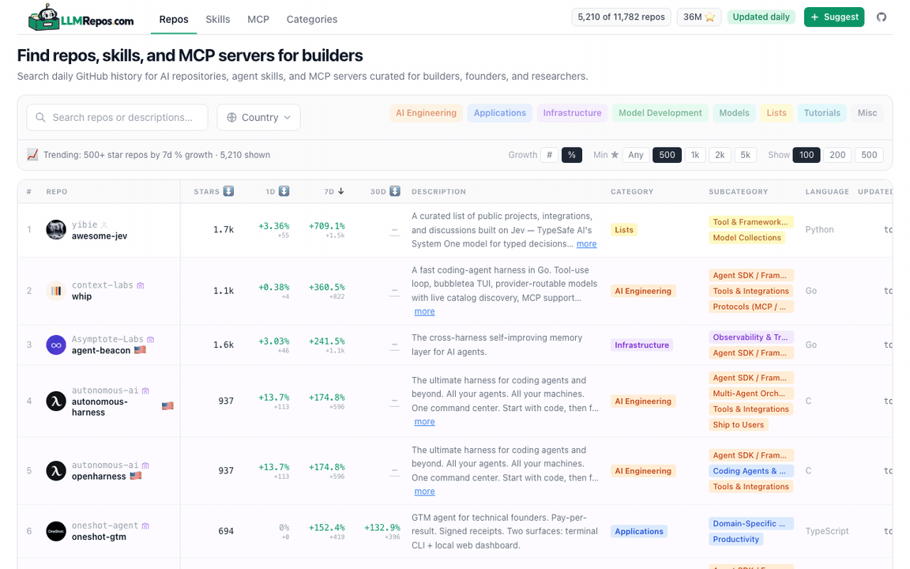

# 👋 Awesome Local LLMs

### 10,000+ open-source LLM, agent, and local inference repos, tracked daily

[**llmrepos.com**](https://llmrepos.com) sorts them by how fast they are gaining stars, not by how many they have.

---

## What this is

A curated list of open-source projects for building with LLMs, covering the whole stack: model weights, training code, inference runtimes, agent frameworks, end-user apps, and the lists and tutorials that help you learn.

Each repo is checked once a day for stars, 1d/7d/30d star growth, forks, contributors, open issues, language, license, creation date, and time since last commit.

Two ways to use it:

- [**llmrepos.com**](https://llmrepos.com) has all 11,000+ repos, with search, growth sorting, and filters by category, subcategory, language, and license.
- **This README** mixes established leaders with projects gaining stars this week, regenerated every Monday.

Projects are organised into eight categories:

- **AI Engineering**: agent SDKs, orchestration, prompting & scaffolding, memory/RAG, tools & integrations, MCP, evaluation, and guardrails
- **Applications**: coding assistants, personal agents, productivity, content creation, research, data analytics, and automation
- **Infrastructure**: local runtimes, production serving, distributed & edge inference, optimisation, gateways, observability, and vector search
- **Model Development**: fine-tuning, training, RLHF, deep learning frameworks, dataset engineering, and interpretability
- **Models**: foundation, vision, audio/speech, embedding, on-device, and domain-specific model releases
- **Lists**: curated collections of prompts, tools, models, papers, and datasets
- **Tutorials**: getting-started guides, courses, roadmaps, and interview prep
- **Misc**: everything else

Each repo is tagged with one **category**, one or more **subcategories**, and a set of cross-cutting **keywords** (techniques, integrations, modalities, and domains such as `RAG`, `MCP`, or `Context engineering`).

**Contributions are welcome!** [Open an issue](https://github.com/vince-lam/awesome-local-llms/issues/new/choose) to suggest a missing repo, correct a listing, or improve the site.

## How the project has changed

This started in 2024 as a markdown list of local LLM tools that I edited by hand and kept in sync with a Google Sheet. It went out of date faster than I could edit it, so it became a pipeline instead.

| | 2024 | 2026 |
|---|---|---|
| Repos tracked | ~40, picked by hand | 8,600+, found via the GitHub API and classified automatically |
| Refresh | Manual, later weekly | Daily, via GitHub Actions into a [Turso](https://turso.tech) (libSQL) database |
| Ranking | Total stars | 1d/7d/30d star growth, so a repo shows up within days of taking off |
| Scope | Local inference and chat UIs | Agents, RAG, coding assistants, serving, model development, evals |
| Surface | This README | [llmrepos.com](https://llmrepos.com), plus this README |

## Elsewhere

- My write-up on local LLM tooling: <https://vinlam.com/posts/local-llm-options/>
- Older exports, no longer updated: [Google Sheet](https://docs.google.com/spreadsheets/d/1Xv38p90V3GiJXjq0a3qc24056Vicn1I5MG6QiFE6nVE/edit?usp=sharing) and [Airtable](https://airtable.com/apparaKqezkq2LECD/shrE26kWFaVU1cvgb)

## Weekly Open-Source LLM & Agent Rankings

These generated rankings combine the 20 most-starred active projects, the 20 largest seven-day movers outside that group, and up to three more movers from each category. Each project appears once. For the complete daily index, search, filters, and longer growth windows, use [llmrepos.com](https://llmrepos.com/?utm_source=github&utm_medium=readme&utm_campaign=readme_funnel).

*Last Updated: 16/11/2026*

<!-- BEGIN_TABLE -->
## Established leaders

The 20 most-starred active projects.

|  # | Repo  |  Stars | 7d growth  | Category  | About  |
|----------|----------|----------|----------|----------|----------|
|  1 | [rea](https://github.com/morluto/rea)  | 463,450 | +17,482 (+3.9%) | AI Engineering | Reverse engineer anything with agents, from app behavior down to native binaries.  |
|  2 | [openclaw](https://github.com/openclaw/openclaw)  | 394,585 | +351 (+0.1%)  | Applications  | The AI that really does things. Any OS. Any Platform. The lobster way. 🦞  |
|  3 | [skills](https://github.com/mattpocock/skills)  | 325,813 | +6,351 (+2.0%)  | AI Engineering | Skills for Real Engineers. Straight from my .agents directory.  |
|  4 | [superpowers](https://github.com/obra/superpowers)  | 318,585 | +3,623 (+1.2%)  | AI Engineering | An agentic skills framework & software development methodology that works.  |
|  5 | [ECC](https://github.com/affaan-m/ECC)  | 304,424 | +4,326 (+1.4%)  | AI Engineering | The agent harness performance optimization system. Skills, instincts, memory, security, and research-first development for Claude Code, Codex, Opencode, Cursor and beyond.  |
|  6 | [deepseek-harness](https://github.com/deepseek-ai/deepseek-harness) | 282,209 | +4,954 (+1.8%)  | AI Engineering | DeepSeek Harness: Everything is a Plugin.  |
|  7 | [hermes-agent](https://github.com/NousResearch/hermes-agent)  | 263,858 | +1,855 (+0.7%)  | AI Engineering | The agent that grows with you  |
|  8 | [opencode](https://github.com/anomalyco/opencode)  | 227,264 | +1,638 (+0.7%)  | Applications  | The open source coding agent.  |
|  9 | [n8n](https://github.com/n8n-io/n8n)  | 210,616 | +698 (+0.3%)  | AI Engineering | Fair-code workflow automation platform with native AI capabilities. Combine visual building with custom code, self-host or cloud, 400+ integrations.  |
|  10 | [firecrawl](https://github.com/firecrawl/firecrawl)  | 202,294 | +2,236 (+1.1%)  | AI Engineering | Supercharge your AI agents with data from the web and beyond. Building the library for superintelligence. 🔥  |
|  11 | [skills](https://github.com/anthropics/skills)  | 195,871 | +5,272 (+2.8%)  | AI Engineering | Public repository for Agent Skills  |
|  12 | [markitdown](https://github.com/microsoft/markitdown)  | 195,730 | +1,150 (+0.6%)  | AI Engineering | Python tool for converting files and office documents to Markdown.  |
|  13 | [ponytail](https://github.com/DietrichGebert/ponytail)  | 192,012 | +4,517 (+2.4%)  | AI Engineering | Makes your AI agent think like the laziest senior dev in the room. The best code is the code you never wrote.  |
|  14 | [AutoGPT](https://github.com/Significant-Gravitas/AutoGPT)  | 188,060 | +88 (+0.0%)  | Applications  | AutoGPT is the vision of accessible AI for everyone, to use and to build on. Our mission is to provide the tools, so that you can focus on what matters.  |
|  15 | [ollama](https://github.com/ollama/ollama)  | 187,236 | +812 (+0.4%)  | Infrastructure | Get up and running with Kimi, GLM, MiniMax, DeepSeek, gpt-oss, Qwen, Gemma and other models.  |
|  16 | [prompts.chat](https://github.com/f/prompts.chat)  | 177,658 | +941 (+0.5%)  | AI Engineering | f.k.a. Awesome ChatGPT Prompts. Share, discover, and collect prompts from the community. Free and open source — self-host for your organization with complete privacy.  |
|  17 | [transformers](https://github.com/huggingface/transformers)  | 169,037 | +347 (+0.2%)  | Infrastructure | 🤗 Transformers: the model-definition framework for state-of-the-art machine learning models in text, vision, audio, and multimodal models, for both inference and training.  |
|  18 | [agency-agents](https://github.com/msitarzewski/agency-agents)  | 168,752 | +1,280 (+0.8%)  | AI Engineering | A complete AI agency at your fingertips - From frontend wizards to Reddit community ninjas, from whimsy injectors to reality checkers. Each agent is a specialized expert with personality, processes, and proven deliverables. |
|  19 | [dify](https://github.com/langgenius/dify)  | 161,282 | +512 (+0.3%)  | AI Engineering | Build Agentic workflows, RAG pipelines, with rich AI model and tool support on one collaborative workspace. Deploy on cloud, VPC, or self-hosted, so teams move from prototype to production without rebuilding the stack.  |
|  20 | [open-webui](https://github.com/open-webui/open-webui)  | 158,826 | +615 (+0.4%)  | AI Engineering | User-friendly AI Interface (Supports Ollama, OpenAI API, ...)  |

## Trending this week

The 20 largest seven-day star gains, excluding established leaders.

|  # | Repo  |  Stars | 7d growth  | Category  | About  |
|----------|----------|----------|----------|----------|----------|
|  1 | [dsh-our-free-model](https://github.com/Ebony-Vinyl/dsh-our-free-model)  |  77,063 | +9,885 (+14.7%) | AI Engineering | 在 dsh 里装上这个插件即可，无需登录、注册或填 API Key，就能使用包括 DeepSeek V4.1 Flash、Kimi K3 在内的前沿模型——完全免费，不限量。 All you do is install this plugin in dsh: no login, no sign-up, no API key — the frontier models are just there, DeepSeek V4.1 Flash and Kimi K3 among them. Completely free, with no usage cap.  |
|  2 | [dsh-Go](https://github.com/ccch1mneyyy/dsh-Go)  |  24,537 | +7,214 (+41.6%) | Applications  | dsh-go — DeepSeek Harness 装进口袋：手机本机运行，也能遥控你的电脑。  |
|  3 | [orca](https://github.com/stablyai/orca)  | 126,598 | +6,401 (+5.3%)  | AI Engineering | Orca lets you run a fleet of coding agents (e.g. Claude Code, Codex) with your own subscription. Available on desktop, mobile and remote runtime.  |
|  4 | [VoiceStudio](https://github.com/debpalash/VoiceStudio)  | 111,746 | +5,975 (+5.6%)  | Applications  | VoiceStudio is the open-source, fully-local ElevenLabs alternative — voice cloning, voice design, video dubbing, dictation, transcription & audiobook creation in 646 languages.  |
|  5 | [univer](https://github.com/dream-num/univer)  |  27,536 | +4,599 (+20.1%) | AI Engineering | Build your own AI office with Univer Office SDK. Bring editing, calculation, collaboration, and file processing into your product for people and AI agents. Built on an extensible open-source core.  |
|  6 | [impeccable](https://github.com/pbakaus/impeccable)  | 111,175 | +4,555 (+4.3%)  | AI Engineering | The design vocabulary for your coding agent. Steer with polish and bolder, review with critique and audit, catch AI slop before it ships.  |
|  7 | [magpie](https://github.com/yetone/magpie)  |  37,493 | +4,492 (+13.6%) | Applications  | Every agent's model. One place. Codex on DeepSeek, Claude Code on Kimi, from the menu bar.  |
|  8 | [agent-desktop](https://github.com/vercel-labs/agent-desktop)  |  24,508 | +4,359 (+21.6%) | AI Engineering | Computer use CLI for AI agents  |
|  9 | [taste-skill](https://github.com/Leonxlnx/taste-skill)  | 116,732 | +4,339 (+3.9%)  | AI Engineering | Agent skills that give coding agents taste: art direction, reference images and a browser check instead of generic AI pages  |
|  10 | [rea-video](https://github.com/JuneYaooo/rea-video)  |  9,543 | +4,310 (+82.4%) | AI Engineering | Reverse-engineer any video, shot by shot: filmed, AI-generated or coded, and how to remake it. Breakdowns in the open VIDEO.md format. 逆向一切视频，逐个镜头看是拍的、AI 生成的还是代码做的，再告诉你怎么复刻；拆解结果按 VIDEO.md 格式输出。  |
|  11 | [elephant-goldfish-model](https://github.com/google/elephant-goldfish-model) |  20,169 | +4,115 (+25.6%) | AI Engineering | Open-source plugin for designing and reviewing software with agents  |
|  12 | [daily_stock_analysis](https://github.com/ZhuLinsen/daily_stock_analysis)  |  72,761 | +4,094 (+6.0%)  | AI Engineering | LLM 驱动的多市场股票智能分析系统：多源行情、实时新闻、决策看板与自动推送，支持零成本定时运行。 LLM-powered multi-market stock analysis system with multi-source market data, real-time news, decision dashboard, automated notifications, and cost-free scheduled runs.  |
|  13 | [graphify](https://github.com/Graphify-Labs/graphify)  | 148,858 | +3,997 (+2.8%)  | AI Engineering | Turn any codebase, with its docs, SQL schemas, configs, and PDFs, into a queryable knowledge graph. A /graphify skill for Claude Code, Cursor, Codex, and Gemini CLI: local deterministic AST parsing, every edge explained, no vector store.  |
|  14 | [agent-skills](https://github.com/addyosmani/agent-skills)  | 118,248 | +3,803 (+3.3%)  | Applications  | Production-grade engineering skills for AI coding agents.  |
|  15 | [freellmapi](https://github.com/tashfeenahmed/freellmapi)  |  53,347 | +3,734 (+7.5%)  | AI Engineering | 10.1 billion tokens per month. 87 free LLM providers. 1,313 free model endpoints. All behind one /v1 endpoint, plus any custom OpenAI-compatible endpoint. Smart routing, automatic failover, encrypted keys. Personal experimentation only.  |
|  16 | [agent-browser](https://github.com/vercel-labs/agent-browser)  |  51,930 | +3,629 (+7.5%)  | AI Engineering | Browser automation CLI for AI agents  |
|  17 | [free-claude-code](https://github.com/Alishahryar1/free-claude-code)  |  70,796 | +3,254 (+4.8%)  | Applications  | Use Claude Code, Codex, Antigravity, VSCode, Pi, and OpenCode (and 6 other harnesses) for free (1.3B+ free tokens) from your terminal, app, IDE, or phone, and now from the browser with native browser sessions (multi-harness + multi-model) like OpenClaw (voice supported + ToS friendly) |
|  18 | [Scrapling](https://github.com/D4Vinci/Scrapling)  | 103,589 | +3,172 (+3.2%)  | AI Engineering | 🕷️ The BEST Web Scraping framework that handles everything from a single request to a full-scale crawl! Don't be shy, join here: https://discord.gg/EMgGbDceNQ and follow here for daily tips and tricks: https://x.com/Scrapling_dev  |
|  19 | [lemo-opuscar](https://github.com/lemomo-ai/lemo-opuscar)  |  17,118 | +3,160 (+22.6%) | Applications  | A toolbox of film styles made in code for Claude Code: 99 ready to use, and your own. Each style is a style prompt plus a demo film made entirely in code by Claude Opus 5.5, with no video model. By Lemomo. · 一套用代码做片的风格工具箱：99 种现成风格，也能做出你自己的  |
|  20 | [open-code-review](https://github.com/alibaba/open-code-review)  |  52,815 | +3,104 (+6.2%)  | Applications  | Secure, fast, efficient, battle-tested at Alibaba's scale. Hybrid architecture code review tool: deterministic pipelines + LLM Agent, precise line-level comments, built-in multi-language ruleset (NPE, thread-safety, XSS, SQL injection), OpenAI & Anthropic compatible.  |

## Trending by category

Up to three more weekly movers from each category. Projects already shown above are omitted.

### [AI Engineering](https://llmrepos.com/categories/ai-engineering?utm_source=github&utm_medium=readme&utm_campaign=readme_funnel)

|  # | Repo  |  Stars | 7d growth  | About  |
|----------|----------|----------|----------|----------|
|  1 | [ui-ux-pro-max-skill](https://github.com/nextlevelbuilder/ui-ux-pro-max-skill) | 150,328 | +3,072 (+2.1%) | An AI skill that provides design intelligence for building professional UI/UX across multiple platforms. |
|  2 | [humanizer](https://github.com/blader/humanizer)  |  69,821 | +2,828 (+4.2%) | Agent skill that removes signs of AI-generated writing from text  |
|  3 | [chrome-devtools-mcp](https://github.com/ChromeDevTools/chrome-devtools-mcp)  |  57,565 | +2,548 (+4.6%) | Chrome DevTools for coding agents  |

### [Applications](https://llmrepos.com/categories/applications?utm_source=github&utm_medium=readme&utm_campaign=readme_funnel)

|  # | Repo  |  Stars | 7d growth  | About  |
|----------|----------|----------|----------|----------|
|  1 | [MoneyPrinterTurbo](https://github.com/harry0703/MoneyPrinterTurbo) | 143,987 | +2,500 (+1.8%)  | 利用 AI 大模型和自动化工作流，根据主题或关键词一键生成高清短视频。Generate HD short videos from a topic or keyword with an automated AI workflow.  |
|  2 | [learnharness](https://github.com/amosblomqvist/learnharness)  |  9,682 | +2,454 (+34.0%) | Agent harness for learning difficult things.  |
|  3 | [openfilm](https://github.com/openfilm/openfilm)  |  7,811 | +2,326 (+42.4%) | The open source AI video agent: turns any coding agent into a video agent, with an editor to change anything it makes. |

### [Infrastructure](https://llmrepos.com/categories/infrastructure?utm_source=github&utm_medium=readme&utm_campaign=readme_funnel)

|  # | Repo  |  Stars | 7d growth  | About  |
|----------|----------|----------|----------|----------|
|  1 | [OmniRoute](https://github.com/cheaper-inference/OmniRoute) |  87,979 | +2,105 (+2.5%)  | Never stop coding. Free MIT AI gateway: one endpoint, 375 providers (150+ free), 1,400+ models Kimi, Claude, GPT, Gemini, GLM, DeepSeek, MiniMax. Works with Claude Code, Codex, Cursor, OpenCode, Cline & Copilot. Quota-aware auto-fallback, RTK+Caveman compression saves 15-95% tokens, MCP/A2A, Desktop/PWA. Built by 900+ contributors |
|  2 | [gputaskman](https://github.com/shanselman/gputaskman)  |  3,392 | +2,018 (+146.9%) | A GPU task manager for Windows, Linux, and WSL: per-process VRAM, GPU activity, and LLM model/KV-cache insights (Windows AMD and NVIDIA).  |
|  3 | [llama.cpp](https://github.com/ggml-org/llama.cpp)  | 135,304 | +1,472 (+1.1%)  | LLM inference in C/C++  |

### [Model Development](https://llmrepos.com/categories/model-development?utm_source=github&utm_medium=readme&utm_campaign=readme_funnel)

|  # | Repo  |  Stars | 7d growth  | About  |
|----------|----------|----------|----------|----------|
|  1 | [strands-decider](https://github.com/strands-labs/strands-decider) |  1,202 | +433 (+56.3%) | A small, fast decision model, or system one model, for agentic workflows. Pick between options or rate on a scale faster than an LLM, with a calibrated confidence on every decision. |
|  2 | [LLMs-from-scratch](https://github.com/rasbt/LLMs-from-scratch)  | 108,517 | +425 (+0.4%)  | Implement a ChatGPT-like LLM in PyTorch from scratch, step by step  |
|  3 | [unsloth](https://github.com/unslothai/unsloth)  |  79,609 | +367 (+0.5%)  | Local UI to run and train LLMs and diffusion models. Supports GGUF, MLX, Qwen3.8, DeepSeek-V4.1, MiniMax-H3, Gemma 4, FLUX and more.  |

### [Models](https://llmrepos.com/categories/models?utm_source=github&utm_medium=readme&utm_campaign=readme_funnel)

|  # | Repo  |  Stars | 7d growth  | About  |
|----------|----------|----------|----------|----------|
|  1 | [GPT-SoVITS](https://github.com/RVC-Boss/GPT-SoVITS) |  65,227 | +587 (+0.9%) | 1 min voice data can also be used to train a good TTS model! (few shot voice cloning)  |
|  2 | [VieNeu-TTS](https://github.com/pnnbao97/VieNeu-TTS) |  3,415 | +240 (+7.6%) | Vietnamese TTS with instant voice cloning • On-device • Real-time CPU inference • 48kHz audio quality • Chuyển văn bản thành giọng nói tiếng Việt • Text to speech tiếng Việt • TTS tiếng Việt |
|  3 | [MOSS-Image](https://github.com/OpenMOSS/MOSS-Image) |  2,913 | +149 (+5.4%) | Official repository for MOSS-Image, a 5B-parameter base DiT model with high-quality text rendering, layout generation, and efficient fine-tuning.  |

### [Lists](https://llmrepos.com/categories/lists?utm_source=github&utm_medium=readme&utm_campaign=readme_funnel)

|  # | Repo  |  Stars | 7d growth  | About  |
|----------|----------|----------|----------|----------|
|  1 | [awesome-gamedev-agent-skills](https://github.com/gamedev-skills/awesome-gamedev-agent-skills) |  9,115 | +1,139 (+14.3%) | Make games with your AI coding agent: 79 game-dev skills and a router for Godot, Unity, Unreal, Roblox, three.js, Phaser and 6 more engines. Checked on the real engines.  |
|  2 | [awesome-opus5-5-videos](https://github.com/yihui-dev/awesome-opus5-5-videos)  |  15,478 | +990 (+6.8%)  | A growing collection of viral videos made with Claude Opus 5.5 and the prompts behind them. Watch each original next to a live remake on Skillry. Updated regularly.  |
|  3 | [marketing-skills](https://github.com/irinabuht12-oss/marketing-skills)  |  7,962 | +875 (+12.3%)  | Claude skills for marketing: 49 free marketing skills for Claude Code and claude.ai (Google Ads, Meta Ads, SEO, AI visibility) + the Ryze Google Ads MCP / Meta Ads MCP: claude mcp add ryze --transport http https://connector.get-ryze.ai/mcp |

### [Tutorials](https://llmrepos.com/categories/tutorials?utm_source=github&utm_medium=readme&utm_campaign=readme_funnel)

|  # | Repo  |  Stars | 7d growth  | About  |
|----------|----------|----------|----------|----------|
|  1 | [figures4papers](https://github.com/ChenLiu-1996/figures4papers) |  12,006 | +1,671 (+16.2%) | My Python scripts to make high-quality figures for publications in top AI conferences and journals. |
|  2 | [ai-agent-book](https://github.com/bojieli/ai-agent-book)  |  58,326 | +756 (+1.3%)  | 《深入理解 AI Agent：设计原理与工程实践》（李博杰 著）开源主仓库：全书正文、编译版 PDF 与按章配套代码  |
|  3 | [ai-infra-book](https://github.com/bojieli/ai-infra-book)  |  7,902 | +478 (+6.4%)  | 《深入理解 AI Infra：量化分析与系统设计》（李博杰 著）开源书稿：从硬件约束和模型架构出发，量化推导 LLM 推理与训练系统设计。含全书正文、PDF、配套计算工具与实验  |

### [Misc](https://llmrepos.com/categories/misc?utm_source=github&utm_medium=readme&utm_campaign=readme_funnel)

|  # | Repo  |  Stars | 7d growth  | About  |
|----------|----------|----------|----------|----------|
|  1 | [keyline-icons](https://github.com/keyline-icons/keyline-icons)  |  223 | +30 (+15.5%) | 1,885 free MIT icons in stroke, two-tone, duotone and fill, rounded or sharp: 15,080 SVGs on one 24×24 grid. Built for shadcn/ui.  |
|  2 | [PublicFreeSuffix](https://github.com/PublicFreeSuffix/PublicFreeSuffix) |  292 | +13 (+4.7%)  | Free Domain Name For Everyone  |
|  3 | [OB1](https://github.com/NateBJones-Projects/OB1)  |  4,778 | +10 (+0.2%)  | Open Brain — The infrastructure layer for your thinking. One database, one AI gateway, one chat channel — any AI plugs in. No middleware, no SaaS. |
<!-- END_TABLE -->

The rankings above require more than 100 stars and a commit within the last 60 days. Weekly movers need a complete seven-day history. [llmrepos.com](https://llmrepos.com/?utm_source=github&utm_medium=readme&utm_campaign=readme_funnel) has the full index, refreshed daily.

## Inspired By

* <https://github.com/janhq/awesome-local-ai>
* <https://huyenchip.com/2024/03/14/ai-oss.html>
* <https://github.com/mahseema/awesome-ai-tools>
* <https://github.com/steven2358/awesome-generative-ai>
* <https://github.com/e2b-dev/awesome-ai-agents>
* <https://github.com/aimerou/awesome-ai-papers>
* <https://github.com/DefTruth/Awesome-LLM-Inference>
* <https://github.com/youssefHosni/Awesome-AI-Data-GitHub-Repos>
