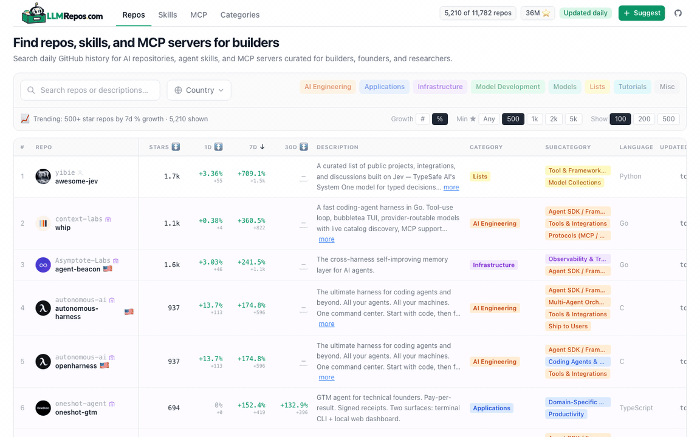

# 👋 Awesome Local LLMs

### 10,000+ open-source LLM, agent, and local inference repos, tracked daily

[**llmrepos.com**](https://llmrepos.com) sorts them by how fast they are gaining stars, not by how many they have.

---

## What this is

A curated list of open-source projects for building with LLMs, covering the whole stack: model weights, training code, inference runtimes, agent frameworks, end-user apps, and the lists and tutorials that help you learn.

Each repo is checked once a day for stars, 1d/7d/30d star growth, forks, contributors, open issues, language, license, creation date, and time since last commit.

Two ways to use it:

- [**llmrepos.com**](https://llmrepos.com) has all 11,000+ repos, with search, growth sorting, and filters by category, subcategory, language, and license.
- **This README** mixes established leaders with projects gaining stars this week, regenerated every Monday.

Projects are organised into eight categories:

- **AI Engineering**: agent SDKs, orchestration, prompting & scaffolding, memory/RAG, tools & integrations, MCP, evaluation, and guardrails
- **Applications**: coding assistants, personal agents, productivity, content creation, research, data analytics, and automation
- **Infrastructure**: local runtimes, production serving, distributed & edge inference, optimisation, gateways, observability, and vector search
- **Model Development**: fine-tuning, training, RLHF, deep learning frameworks, dataset engineering, and interpretability
- **Models**: foundation, vision, audio/speech, embedding, on-device, and domain-specific model releases
- **Lists**: curated collections of prompts, tools, models, papers, and datasets
- **Tutorials**: getting-started guides, courses, roadmaps, and interview prep
- **Misc**: everything else

Each repo is tagged with one **category**, one or more **subcategories**, and a set of cross-cutting **keywords** (techniques, integrations, modalities, and domains such as `RAG`, `MCP`, or `Context engineering`).

**Contributions are welcome!** [Open an issue](https://github.com/vince-lam/awesome-local-llms/issues/new/choose) to suggest a missing repo, correct a listing, or improve the site.

## How the project has changed

This started in 2024 as a markdown list of local LLM tools that I edited by hand and kept in sync with a Google Sheet. It went out of date faster than I could edit it, so it became a pipeline instead.

| | 2024 | 2026 |
|---|---|---|
| Repos tracked | ~40, picked by hand | 8,600+, found via the GitHub API and classified automatically |
| Refresh | Manual, later weekly | Daily, via GitHub Actions into a [Turso](https://turso.tech) (libSQL) database |
| Ranking | Total stars | 1d/7d/30d star growth, so a repo shows up within days of taking off |
| Scope | Local inference and chat UIs | Agents, RAG, coding assistants, serving, model development, evals |
| Surface | This README | [llmrepos.com](https://llmrepos.com), plus this README |

## Elsewhere

- My write-up on local LLM tooling: <https://vinlam.com/posts/local-llm-options/>
- Older exports, no longer updated: [Google Sheet](https://docs.google.com/spreadsheets/d/1Xv38p90V3GiJXjq0a3qc24056Vicn1I5MG6QiFE6nVE/edit?usp=sharing) and [Airtable](https://airtable.com/apparaKqezkq2LECD/shrE26kWFaVU1cvgb)

## Weekly Open-Source LLM & Agent Rankings

These generated rankings combine the 20 most-starred active projects, the 20 largest seven-day movers outside that group, and up to three more movers from each category. Each project appears once. For the complete daily index, search, filters, and longer growth windows, use [llmrepos.com](https://llmrepos.com/?utm_source=github&utm_medium=readme&utm_campaign=readme_funnel).

*Last Updated: 26/10/2026*

<!-- BEGIN_TABLE -->
## Established leaders

The 20 most-starred active projects.

|  # | Repo  |  Stars | 7d growth  | Category  | About  |
|----------|----------|----------|----------|----------|----------|
|  1 | [openclaw](https://github.com/openclaw/openclaw)  | 393,127 | +677 (+0.2%)  | Applications  | The AI that really does things. Any OS. Any Platform. The lobster way. 🦞  |
|  2 | [rea](https://github.com/morluto/rea)  | 388,510 | +57,647 (+17.4%) | AI Engineering | Reverse engineer anything with agents, from app behavior down to native binaries.  |
|  3 | [superpowers](https://github.com/obra/superpowers)  | 305,380 | +3,420 (+1.1%)  | AI Engineering | An agentic skills framework & software development methodology that works.  |
|  4 | [skills](https://github.com/mattpocock/skills)  | 303,725 | +6,673 (+2.2%)  | AI Engineering | Skills for Real Engineers. Straight from my .agents directory.  |
|  5 | [ECC](https://github.com/affaan-m/ECC)  | 289,377 | +5,595 (+2.0%)  | AI Engineering | The agent harness performance optimization system. Skills, instincts, memory, security, and research-first development for Claude Code, Codex, Opencode, Cursor and beyond.  |
|  6 | [deepseek-harness](https://github.com/deepseek-ai/deepseek-harness) | 262,166 | +8,057 (+3.2%)  | AI Engineering | DeepSeek Harness: Everything is a Plugin.  |
|  7 | [hermes-agent](https://github.com/NousResearch/hermes-agent)  | 257,279 | +2,097 (+0.8%)  | AI Engineering | The agent that grows with you  |
|  8 | [opencode](https://github.com/anomalyco/opencode)  | 221,799 | +4,478 (+2.1%)  | Applications  | The open source coding agent.  |
|  9 | [n8n](https://github.com/n8n-io/n8n)  | 208,643 | +646 (+0.3%)  | AI Engineering | Fair-code workflow automation platform with native AI capabilities. Combine visual building with custom code, self-host or cloud, 400+ integrations.  |
|  10 | [firecrawl](https://github.com/firecrawl/firecrawl)  | 195,545 | +2,551 (+1.3%)  | AI Engineering | Supercharge your AI agents with data from the web and beyond. Building the library for superintelligence. 🔥  |
|  11 | [markitdown](https://github.com/microsoft/markitdown)  | 192,300 | +1,239 (+0.6%)  | AI Engineering | Python tool for converting files and office documents to Markdown.  |
|  12 | [AutoGPT](https://github.com/Significant-Gravitas/AutoGPT)  | 187,762 | +107 (+0.1%)  | Applications  | AutoGPT is the vision of accessible AI for everyone, to use and to build on. Our mission is to provide the tools, so that you can focus on what matters.  |
|  13 | [ollama](https://github.com/ollama/ollama)  | 184,848 | +1,031 (+0.6%)  | Infrastructure | Get up and running with Kimi, GLM, MiniMax, DeepSeek, gpt-oss, Qwen, Gemma and other models.  |
|  14 | [skills](https://github.com/anthropics/skills)  | 183,899 | +1,743 (+1.0%)  | AI Engineering | Public repository for Agent Skills  |
|  15 | [ponytail](https://github.com/DietrichGebert/ponytail)  | 176,766 | +9,077 (+5.4%)  | AI Engineering | Makes your AI agent think like the laziest senior dev in the room. The best code is the code you never wrote.  |
|  16 | [prompts.chat](https://github.com/f/prompts.chat)  | 174,640 | +1,098 (+0.6%)  | AI Engineering | f.k.a. Awesome ChatGPT Prompts. Share, discover, and collect prompts from the community. Free and open source — self-host for your organization with complete privacy.  |
|  17 | [transformers](https://github.com/huggingface/transformers)  | 168,192 | +340 (+0.2%)  | Infrastructure | 🤗 Transformers: the model-definition framework for state-of-the-art machine learning models in text, vision, audio, and multimodal models, for both inference and training.  |
|  18 | [agency-agents](https://github.com/msitarzewski/agency-agents)  | 164,157 | +2,617 (+1.6%)  | AI Engineering | A complete AI agency at your fingertips - From frontend wizards to Reddit community ninjas, from whimsy injectors to reality checkers. Each agent is a specialized expert with personality, processes, and proven deliverables. |
|  19 | [dify](https://github.com/langgenius/dify)  | 159,596 | +708 (+0.4%)  | AI Engineering | Build Agentic workflows, RAG pipelines, with rich AI model and tool support on one collaborative workspace. Deploy on cloud, VPC, or self-hosted, so teams move from prototype to production without rebuilding the stack.  |
|  20 | [open-webui](https://github.com/open-webui/open-webui)  | 156,812 | +659 (+0.4%)  | AI Engineering | User-friendly AI Interface (Supports Ollama, OpenAI API, ...)  |

## Trending this week

The 20 largest seven-day star gains, excluding established leaders.

|  # | Repo  |  Stars | 7d growth  | Category  | About  |
|----------|----------|----------|----------|----------|----------|
|  1 | [dsh-our-free-model](https://github.com/Ebony-Vinyl/dsh-our-free-model)  |  44,150 | +17,112 (+63.3%) | AI Engineering | 在 dsh 里装上这个插件即可，无需登录、注册或填 API Key，就能使用包括 DeepSeek V4.1 Flash、Kimi K3 在内的前沿模型——完全免费，不限量。 All you do is install this plugin in dsh: no login, no sign-up, no API key — the frontier models are just there, DeepSeek V4.1 Flash and Kimi K3 among them. Completely free, with no usage cap.  |
|  2 | [dsh-our-free-model](https://github.com/zouyuxuan122/dsh-our-free-model)  |  44,151 | +17,013 (+62.7%) | AI Engineering | 在 dsh 里装上这个插件即可，无需登录、注册或填 API Key，就能使用包括 DeepSeek V4.1 Flash、Kimi K3 在内的前沿模型——完全免费，不限量。 All you do is install this plugin in dsh: no login, no sign-up, no API key — the frontier models are just there, DeepSeek V4.1 Flash and Kimi K3 among them. Completely free, with no usage cap.  |
|  3 | [security-audit-skill](https://github.com/cloudflare/security-audit-skill)  |  47,849 | +16,423 (+52.3%) | AI Engineering | A coding-agent skill for multi-phase security audits with independently verified, machine-readable findings  |
|  4 | [VoiceStudio](https://github.com/debpalash/VoiceStudio)  |  87,977 | +11,279 (+14.7%) | Applications  | VoiceStudio is the open-source, fully-local ElevenLabs alternative — voice cloning, voice design, video dubbing, dictation, transcription & audiobook creation in 646 languages.  |
|  5 | [orca](https://github.com/stablyai/orca)  | 106,647 | +8,867 (+9.1%)  | AI Engineering | Orca is the place for working with a fleet of agents (e.g. Grok Bot, Claude Code). Run any coding agent with your own subscription. Available on desktop, mobile and remote runtime.  |
|  6 | [graphify](https://github.com/Graphify-Labs/graphify)  | 135,767 | +6,933 (+5.4%)  | AI Engineering | Turn any codebase, with its docs, SQL schemas, configs, and PDFs, into a queryable knowledge graph. A /graphify skill for Claude Code, Cursor, Codex, and Gemini CLI: local deterministic AST parsing, every edge explained, no vector store.  |
|  7 | [xerj](https://github.com/xerj-org/xerj)  |  15,749 | +6,888 (+77.7%)  | Infrastructure | Local-first search engine and MCP server for AI agents. One Rust binary indexes code, docs, logs, JSONL/CSV and PDFs for BM25 full-text, vector and hybrid search, code search without grep, agent memory and RAG. Elasticsearch-compatible API; Corpus Hub serves hundreds of reference memory corpora. |
|  8 | [magpie](https://github.com/yetone/magpie)  |  22,230 | +5,517 (+33.0%)  | Applications  | Every agent's model. One place. Codex on DeepSeek, Claude Code on Kimi, from the menu bar.  |
|  9 | [ppt-master](https://github.com/hugohe3/ppt-master)  |  68,779 | +4,996 (+7.8%)  | Applications  | AI turns documents or topics into real, native PowerPoint decks—with native shapes, transitions and animations, data-backed charts and tables on demand, audio narration from speaker notes, and support for your own .pptx templates. · by Hugo He  |
|  10 | [awesome-opus5-5-videos](https://github.com/yihui-dev/awesome-opus5-5-videos) |  11,331 | +4,881 (+75.7%)  | Lists  | A growing collection of viral videos made with Claude Opus 5.5 and the prompts behind them. Watch each original next to a live remake on Skillry. Updated regularly.  |
|  11 | [iFixAi](https://github.com/ifixai-ai/iFixAi)  |  34,751 | +4,880 (+16.3%)  | AI Engineering | Independent Auditing of AI Agents. Run by human or the agent itself, to answer the most crucial question in the AI Agent Economy. Is the agent doing what is supposed to do? With iFixAi you can have this answer in less than 120 seconds.  |
|  12 | [freellmapi](https://github.com/tashfeenahmed/freellmapi)  |  41,934 | +4,529 (+12.1%)  | AI Engineering | 7.4 billion tokens per month. 34 free LLM providers. 635 free model endpoints. All behind one /v1 endpoint, plus any custom OpenAI-compatible endpoint. Smart routing, automatic failover, encrypted keys. Personal experimentation only.  |
|  13 | [anatomy](https://github.com/wheresryan22/anatomy)  |  20,876 | +4,347 (+26.3%)  | AI Engineering | An agent skill for creating detailed, interactive isometric illustrations of real-world machines and complex systems. Generates polished SVGs with optional WebGL shaders and 3D effects.  |
|  14 | [lemo-opuscar](https://github.com/lemomo-ai/lemo-opuscar)  |  7,822 | +4,310 (+122.7%) | Applications  | A toolbox of film styles made in code for Claude Code: 59 ready to use, and your own. Each style is a style prompt plus a demo film made entirely in code by Claude Opus 5.5, with no video model. By Lemomo. · 一套用代码做片的风格工具箱：59 种现成风格，也能做出你自己的  |
|  15 | [solidcraft](https://github.com/tangency-labs/solidcraft)  |  10,652 | +4,185 (+64.7%)  | Applications  | SolidCraft: an open-source parametric 3D CAD application built in pure Rust. Desktop, web, and automation through MCP.  |
|  16 | [solidcraft](https://github.com/bherbruck/solidcraft)  |  10,653 | +4,184 (+64.7%)  | Applications  | SolidCraft: an open-source parametric 3D CAD application built in pure Rust. Desktop, web, and automation through MCP.  |
|  17 | [solvecraft](https://github.com/bherbruck/solvecraft)  |  10,653 | +4,184 (+64.7%)  | Applications  | SolidCraft: an open-source parametric 3D CAD application built in pure Rust. Desktop, web, and automation through MCP.  |
|  18 | [archify](https://github.com/tt-a1i/archify)  |  89,567 | +3,894 (+4.5%)  | AI Engineering | Turn any idea, plan, or codebase into a beautiful interactive diagram. An agent skill for Claude Code, Codex, and more.  |
|  19 | [ComfyUI](https://github.com/Comfy-Org/ComfyUI)  | 143,159 | +3,839 (+2.8%)  | Infrastructure | The most powerful and modular diffusion model GUI, api and backend with a graph/nodes interface. The fastest local inference engine in the world.  |
|  20 | [Agent-Reach](https://github.com/Panniantong/Agent-Reach)  | 103,068 | +3,618 (+3.6%)  | Applications  | Give your AI agent eyes to see the entire internet. Read & search Twitter, Reddit, YouTube, GitHub, Bilibili, XiaoHongShu — one CLI, zero API fees.  |

## Trending by category

Up to three more weekly movers from each category. Projects already shown above are omitted.

### [AI Engineering](https://llmrepos.com/categories/ai-engineering?utm_source=github&utm_medium=readme&utm_campaign=readme_funnel)

|  # | Repo  |  Stars | 7d growth  | About  |
|----------|----------|----------|----------|----------|
|  1 | [taste-skill](https://github.com/Leonxlnx/taste-skill)  | 102,762 | +3,575 (+3.6%) | Agent skills that give coding agents taste: art direction, reference images and a browser check instead of generic AI pages  |
|  2 | [TradingAgents](https://github.com/TauricResearch/TradingAgents) | 115,493 | +3,454 (+3.1%) | TradingAgents: Multi-Agents LLM Financial Trading Framework  |
|  3 | [claude-howto](https://github.com/luongnv89/claude-howto)  |  45,226 | +3,271 (+7.8%) | A visual, example-driven guide to Claude Code — from basic concepts to advanced agents, with copy-paste templates that bring immediate value. |

### [Applications](https://llmrepos.com/categories/applications?utm_source=github&utm_medium=readme&utm_campaign=readme_funnel)

|  # | Repo  |  Stars | 7d growth  | About  |
|----------|----------|----------|----------|----------|
|  1 | [world-model-harness](https://github.com/experientiallabs/world-model-harness) |  13,119 | +3,387 (+34.8%) | Experiential is the open source, zero markup gateway for BYOK, self-hosted and 1000+ marketplace models. It learns from your traffic to cut costs, recommend better models, and train a specialized model you own.  |
|  2 | [ai-memory](https://github.com/akitaonrails/ai-memory)  |  13,670 | +2,751 (+25.2%) | Solution for long term memory for agent coding CLIs and to facilitate handoff between different agent vendors  |
|  3 | [claude-seo](https://github.com/AgriciDaniel/claude-seo)  |  21,818 | +2,572 (+13.4%) | Universal SEO skill for Claude Code. 26 sub-skills + 19 sub-agents covering technical SEO, E-E-A-T, schema, GEO/AEO, agent readiness (Lighthouse Agentic Browsing, WebMCP, llms.txt), backlinks, local SEO, e-commerce, international SEO, Google APIs, and PDF/Excel reporting. 9 optional extensions for live SEO data. |

### [Infrastructure](https://llmrepos.com/categories/infrastructure?utm_source=github&utm_medium=readme&utm_campaign=readme_funnel)

|  # | Repo  |  Stars | 7d growth  | About  |
|----------|----------|----------|----------|----------|
|  1 | [OmniRoute](https://github.com/diegosouzapw/OmniRoute) |  81,338 | +3,001 (+3.8%)  | Never stop coding. Free MIT AI gateway: one endpoint, 375 providers (150+ free), 1,400+ models Kimi, Claude, GPT, Gemini, GLM, DeepSeek, MiniMax. Works with Claude Code, Codex, Cursor, OpenCode, Cline & Copilot. Quota-aware auto-fallback, RTK+Caveman compression saves 15-95% tokens, MCP/A2A, Desktop/PWA. Built by 900+ contributors |
|  2 | [folkbench](https://github.com/Folkbench/folkbench)  |  3,717 | +1,786 (+92.5%) | AI API 中转站评测排行与切换工具：实测可用率、延迟与价格 · Open-source AI API relay benchmark, rankings & switcher for Claude Code / Codex  |
|  3 | [vllm](https://github.com/vllm-project/vllm)  |  95,596 | +1,459 (+1.5%)  | A high-throughput and memory-efficient inference and serving engine for LLMs  |

### [Model Development](https://llmrepos.com/categories/model-development?utm_source=github&utm_medium=readme&utm_campaign=readme_funnel)

|  # | Repo  |  Stars | 7d growth  | About  |
|----------|----------|----------|----------|----------|
|  1 | [LLMs-from-scratch](https://github.com/rasbt/LLMs-from-scratch) | 107,328 | +471 (+0.4%) | Implement a ChatGPT-like LLM in PyTorch from scratch, step by step  |
|  2 | [unsloth](https://github.com/unslothai/unsloth)  |  78,587 | +333 (+0.4%) | Local UI to run and train LLMs and diffusion models. Supports GGUF, MLX, Qwen3.8, DeepSeek-V4.1, MiniMax-H3, Gemma 4, FLUX and more. |
|  3 | [Soup](https://github.com/MakazhanAlpamys/Soup)  |  9,685 | +280 (+3.0%) | Fine-tune LLMs from one YAML. Layer streaming trains an 8B model on a 4 GB laptop GPU.  |

### [Models](https://llmrepos.com/categories/models?utm_source=github&utm_medium=readme&utm_campaign=readme_funnel)

|  # | Repo  |  Stars | 7d growth  | About  |
|----------|----------|----------|----------|----------|
|  1 | [MOSS-Image](https://github.com/OpenMOSS/MOSS-Image)  |  1,917 | +1,061 (+123.9%) | Official repository for MOSS-Image, a 5B-parameter base DiT model with high-quality text rendering, layout generation, and efficient fine-tuning.  |
|  2 | [StartLux-Decision](https://github.com/StartLuxLabs/StartLux-Decision) |  1,578 | +794 (+101.3%)  | Open decision models from 0.8B to 27B: a calibrated probability for every option in one pass, and a short thought only when unsure. Engine for vLLM, llama.cpp and MLX. |
|  3 | [GPT-SoVITS](https://github.com/RVC-Boss/GPT-SoVITS)  |  63,799 | +608 (+1.0%)  | 1 min voice data can also be used to train a good TTS model! (few shot voice cloning)  |

### [Lists](https://llmrepos.com/categories/lists?utm_source=github&utm_medium=readme&utm_campaign=readme_funnel)

|  # | Repo  |  Stars | 7d growth  | About  |
|----------|----------|----------|----------|----------|
|  1 | [awesome-gamedev-agent-skills](https://github.com/gamedev-skills/awesome-gamedev-agent-skills) |  4,622 | +2,978 (+181.1%) | 74 game-dev skills for AI coding agents — Godot, Unity, Unreal, Phaser, PixiJS, three.js, Bevy, pygame, LÖVE, Roblox. Portable SKILL.md Agent Skills (the format Anthropic launched as Claude Skills), with a router that loads the right skill for your engine and task. Runs in Claude Code, Cursor, Kiro, Codex, Copilot, Gemini CLI and more. |
|  2 | [marketing-skills](https://github.com/irinabuht12-oss/marketing-skills)  |  5,806 | +805 (+16.1%)  | Claude skills for marketing: 49 free marketing skills for Claude Code and claude.ai (Google Ads, Meta Ads, SEO, AI visibility) + the Ryze Google Ads MCP / Meta Ads MCP: claude mcp add ryze --transport http https://connector.get-ryze.ai/mcp  |
|  3 | [awesome-free-llm-apis](https://github.com/mnfst/awesome-free-llm-apis)  |  11,324 | +652 (+6.1%)  | List of Permanent Free LLM API (API Keys)  |

### [Tutorials](https://llmrepos.com/categories/tutorials?utm_source=github&utm_medium=readme&utm_campaign=readme_funnel)

|  # | Repo  |  Stars | 7d growth  | About  |
|----------|----------|----------|----------|----------|
|  1 | [ai-agent-book](https://github.com/bojieli/ai-agent-book)  |  55,954 | +1,020 (+1.9%) | 《深入理解 AI Agent：设计原理与工程实践》（李博杰 著）开源主仓库：全书正文、编译版 PDF 与按章配套代码  |
|  2 | [cs249r_book](https://github.com/harvard-edge/cs249r_book) |  29,668 | +587 (+2.0%)  | Machine Learning Systems: Foundations, Scaling, Agentic AI, and Physical AI (Vols I–IV) • Harvard CS249r \| https://mlsysbook.ai |
|  3 | [ai-infra-book](https://github.com/bojieli/ai-infra-book)  |  7,001 | +278 (+4.1%)  | 《深入理解 AI Infra：量化分析与系统设计》（李博杰 著）开源书稿：从硬件约束和模型架构出发，量化推导 LLM 推理与训练系统设计。含全书正文、PDF、配套计算工具与实验  |

### [Misc](https://llmrepos.com/categories/misc?utm_source=github&utm_medium=readme&utm_campaign=readme_funnel)

|  # | Repo  |  Stars | 7d growth  | About  |
|----------|----------|----------|----------|----------|
|  1 | [WhisperLive](https://github.com/collabora/WhisperLive)  |  4,336 | +12 (+0.3%) | A nearly-live implementation of OpenAI's Whisper.  |
|  2 | [keyline-icons](https://github.com/keyline-icons/keyline-icons) |  181 | +10 (+5.8%) | 1,623 free MIT icons in stroke, two-tone, duotone and fill, rounded or sharp: 12,984 SVGs on one 24×24 grid. Built for shadcn/ui.  |
|  3 | [OB1](https://github.com/NateBJones-Projects/OB1)  |  4,742 | +6 (+0.1%)  | Open Brain — The infrastructure layer for your thinking. One database, one AI gateway, one chat channel — any AI plugs in. No middleware, no SaaS. |
<!-- END_TABLE -->

The rankings above require more than 100 stars and a commit within the last 60 days. Weekly movers need a complete seven-day history. [llmrepos.com](https://llmrepos.com/?utm_source=github&utm_medium=readme&utm_campaign=readme_funnel) has the full index, refreshed daily.

## Inspired By

* <https://github.com/janhq/awesome-local-ai>
* <https://huyenchip.com/2024/03/14/ai-oss.html>
* <https://github.com/mahseema/awesome-ai-tools>
* <https://github.com/steven2358/awesome-generative-ai>
* <https://github.com/e2b-dev/awesome-ai-agents>
* <https://github.com/aimerou/awesome-ai-papers>
* <https://github.com/DefTruth/Awesome-LLM-Inference>
* <https://github.com/youssefHosni/Awesome-AI-Data-GitHub-Repos>
